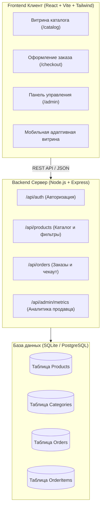
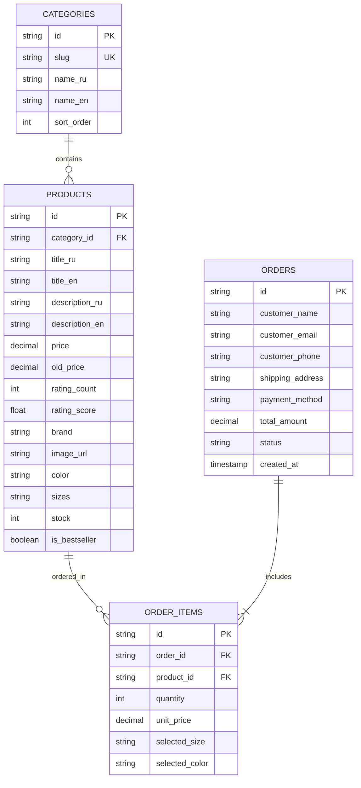

# Архитектура проекта White-Label E-Commerce Platform

Этот документ описывает техническую архитектуру, стек технологий, модель данных и интерфейсы платформы электронной коммерции с поддержкой white-label брендинга.

---

## 1. Обзор системы

Платформа представляет собой полнофункциональный интернет-магазин с витриной товаров, оформлением заказа, мультиязычностью и панелью управления администратора (продавца).



---

## 2. Технологический стек

| Слой | Технология | Обоснование |
| :--- | :--- | :--- |
| **Frontend Framework** | **React 18+ (Vite)** | Мгновенный HMR, компонентный подход, простота поддержки. |
| **Стилизация** | **Tailwind CSS** | Полная интеграция с дизайн-токенами Stitch (Luminescent Commerce). |
| **Иконки и шрифты** | **Google Fonts** (Plus Jakarta Sans, Inter), Material Symbols | Точное соответствие утвержденным дизайн-макетам. |
| **Управление состоянием** | **React Context / Zustand** | Легковесное управление корзиной, фильтрами и локализацией. |
| **Backend API** | **Node.js (Express / Fastify)** | Быстрый асинхронный REST API, разделение роутов и контроллеров. |
| **База данных** | **SQLite (Better-SQLite3)** | Нулевая конфигурация для быстрого локального запуска и возможность миграции на PostgreSQL. |

---

## 3. Схема базы данных



---

## 4. Спецификация REST API

### 4.1. Каталог товаров
* `GET /api/products` — список товаров с пагинацией, фильтрацией по категории, бренду, цене, размерам и поиском.
* `GET /api/products/:id` — детальная информация о товаре.
* `GET /api/categories` — список доступных категорий.

### 4.2. Корзина и Заказы
* `POST /api/orders` — создание нового заказа:
  ```json
  {
    "customer": {
      "name": "Иван Иванов",
      "email": "ivan@example.com",
      "phone": "+7 999 123-45-67",
      "address": "г. Москва, ул. Ленина, д. 10"
    },
    "items": [
      { "productId": "prod_1", "quantity": 1, "size": "M", "color": "Forest Green" }
    ],
    "paymentMethod": "card"
  }
  ```
* `GET /api/orders/:id` — получение статуса заказа.

### 4.3. Панель администратора
* `GET /api/admin/metrics` — сводные метрики (выручка, количество заказов, средний чек, конверсия).
* `GET /api/admin/orders` — список всех заказов с фильтрами по статусам.
* `PATCH /api/admin/orders/:id/status` — обновление статуса заказа (`pending`, `paid`, `shipped`, `delivered`).

---

## 5. Дорожная карта реализации (Roadmap)

1. [x] **Этап 1: Генерация прототипов UI** — 8 экранов созданы в Google Stitch и сохранены в репозиторий.
2. [x] **Этап 2: Архитектурный манифест и правила** — согласованы `ARCHITECTURE.md` и `AGENTS.md`.
3. [ ] **Этап 3: Инициализация Git & публикация на GitHub**.
4. [ ] **Этап 4: Backend API** — легковесный сервер Node.js + SQLite база данных с демо-товарами.
5. [ ] **Этап 5: Frontend интеграция** — единое SPA/MPA приложение, связка витрины, корзины, чекаута и админки.
